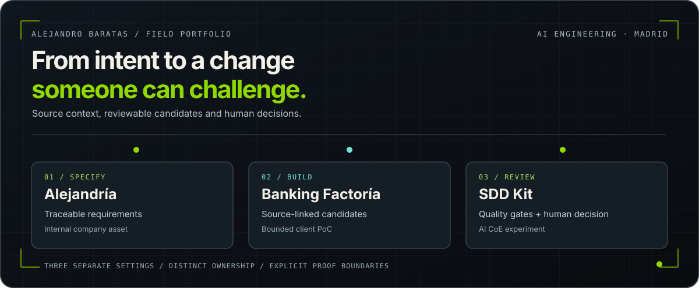

# Alejandro Baratas

**AI Tech Lead · agent-assisted engineering · Madrid**

I help engineering teams put project-aware agents, reviewable changes and human quality gates to work. My background spans HPE, NTT DATA, Ayesa and knowmad mood.

[Explore the portfolio](https://alejandrobgn.vercel.app/) · [Selected work](https://alejandrobgn.vercel.app/work) · [Engineering method](https://alejandrobgn.vercel.app/engineering) · [CV (PDF)](https://alejandrobgn.vercel.app/Alejandro-Baratas-CV.pdf)

[](https://alejandrobgn.vercel.app/engineering)

*Three settings, one recurring question: what evidence makes an AI-assisted change safe to review? The illustration maps related work; these assets do not run together as one deployed system.*

## Start with the work

| Setting | What changed | Inspect |
| --- | --- | --- |
| **Cybersecurity · engineering enablement** | A participating team began using project-aware assistance, agent-proposed PRs and an adapted specification-and-review process within a month, according to the delivery account. | [Read the case →](https://alejandrobgn.vercel.app/work/cybersecurity-ai-engineering) |
| **Banking · modernization PoC** | A bounded reference exercise produced source-linked candidate assets; 22,995 records link to file, line and SHA-256, and 4,338 files were compared across two runs. | [Read the case →](https://alejandrobgn.vercel.app/work/banking-modernization) |
| **Public sector · developer copilots** | A Java backend agent package with ten specialist skills and three agents went through twelve reported audit rounds before handover. | [Read the case →](https://alejandrobgn.vercel.app/work/public-sector-copilots) |

These engagements are anonymized. Their pages distinguish delivery-team records and bounded technical checks from independently verified client outcomes.

## The method behind the cases

I work from a specification and source context toward a candidate change that an engineer can inspect, challenge and authorize. The portfolio shows how that idea developed in **separate settings**:

- **Alejandría** — a company-owned internal accelerator for traceable requirements, delivery packs and a verifier. [See its recorded scope](https://alejandrobgn.vercel.app/engineering#evidence).
- **Banking Factoría** — a client PoC exploring source inventory, a canonical model, deterministic generation and repeatability on a bounded reference module. [Inspect the Anatomy](https://alejandrobgn.vercel.app/work/banking-modernization#anatomy).
- **SDD Kit** — an OpenSpec-based review-gate experiment developed with colleagues in the AI CoE. Its blind comparisons also exposed where the method lost to a simpler baseline. [Read the field note and interactive press](https://alejandrobgn.vercel.app/writing/when-my-quality-gates-lost).

The [evidence register](https://alejandrobgn.vercel.app/engineering#evidence) records what each asset demonstrates, who owns it and where the proof ends.

## Choose a path through the portfolio

| If you want to… | Go to… |
| --- | --- |
| Evaluate delivery in real organizations | [Three anonymized enterprise cases](https://alejandrobgn.vercel.app/work) |
| Explore the source, candidate and review decisions | [Engineering method and evidence register](https://alejandrobgn.vercel.app/engineering) |
| Inspect public code and its actual maturity | [Engineering systems](https://alejandrobgn.vercel.app/systems) · [A2A platform repository](https://github.com/jandromani/A2A) |
| Follow links between work, systems, labs and writing | [Interactive Atlas](https://alejandrobgn.vercel.app/atlas) · [JSON graph](https://alejandrobgn.vercel.app/atlas/graph.json) |
| See original browser experiments | [Labs](https://alejandrobgn.vercel.app/labs) |
| Read the decisions and failed evaluations | [Technical writing](https://alejandrobgn.vercel.app/writing) |

## This repository

This is the source for the [live portfolio](https://alejandrobgn.vercel.app/). The site uses Next.js 16, React 19 and TypeScript. Case studies, the Atlas, interactive Anatomy figures and the evidence register are implemented here; confidential client material is not.

| Directory | Purpose |
| --- | --- |
| `app/` | Pages, metadata, JSON routes and Open Graph images |
| `components/` | Anatomy diagrams, Atlas explorer and shared interface |
| `content/` and `data/` | Field notes, figures and structured portfolio content |
| `lib/` | Evidence models, graph relationships and SEO |
| `public/labs/original/` | Preserved standalone HTML experiments |

Run locally with Node.js **20.9+** and **pnpm 10.12.1**:

```bash
pnpm install
pnpm dev
```

Open `http://localhost:3000`. For a production build and the repository's content checks:

```bash
pnpm build
pnpm typecheck
node scripts/seo-audit.mjs
node scripts/evidence-integrity.mjs
```

## Evidence and reuse

Public source and interactive illustrations let you inspect the presentation and implementation. Enterprise measurements come from bounded private records and are described as such on their respective pages; this repository does not contain client source, independent testimonials or proof of full-estate migration. Company and client assets remain with their respective owners. No open-source licence is granted for this portfolio by default.

---

[Portfolio](https://alejandrobgn.vercel.app/) · [LinkedIn](https://www.linkedin.com/in/alejandro-bgn/) · [Contact](https://alejandrobgn.vercel.app/contact)
